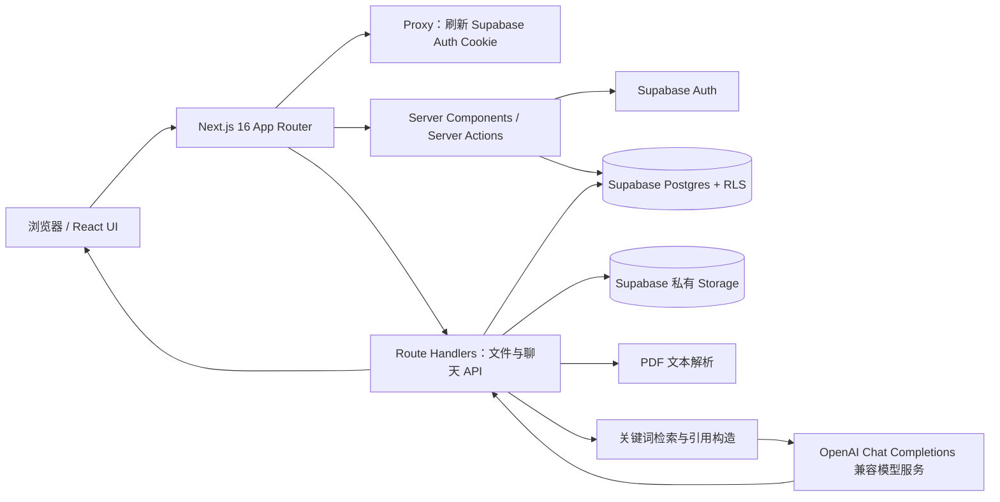
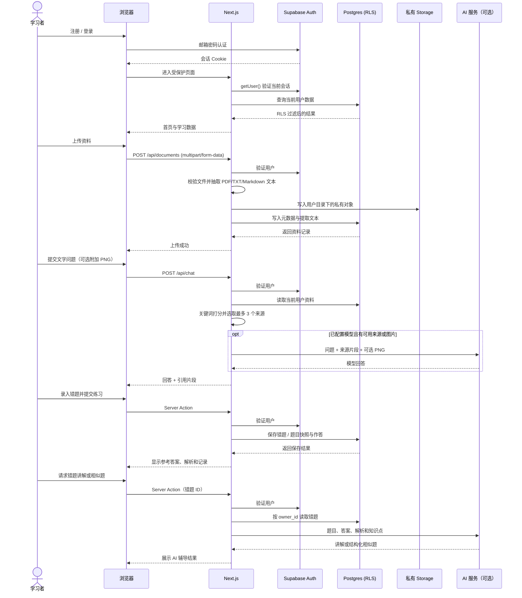

# Sbook 技术文档

> 本文以仓库当前实现为准。为便于区分现状和后续设计，标注为“已实现”的内容可在当前版本使用；“规划”内容不代表已经上线。

## 1. 项目概述

### 1.1 项目背景

学习资料、错题和练习记录分散在文件夹、笔记应用和聊天记录中时，复习需要在多个工具之间切换。Sbook 将个人资料管理、错题整理和基于资料的问答放在同一 Web 应用中，降低回顾资料和定位原文的成本。

### 1.2 项目定位

Sbook 是面向个人学习者的 Web 学习知识库 MVP。当前重点是：

- 将常用学习资料集中保存，并通过分类、标签和文件名快速查找。
- 记录错题、参考答案、解析和知识点，并从错题发起练习。
- 对已提取文本的个人资料进行关键词检索问答，展示可核对的资料引用。
- 通过账号认证、数据库行级安全策略和私有对象存储隔离不同用户的数据。

产品定位不是通用网盘、自动批改平台或已经具备完整知识图谱的 AI Agent 系统。

### 1.3 目标用户与使用场景

| 用户 | 典型场景 |
| --- | --- |
| 个人学习者 | 上传讲义或笔记，按课程/主题整理，提问并回看引用原文 |
| 备考用户 | 手动归档错题、补充解析，从错题列表中选择题目复习 |
| 自主学习者 | 在一个账号下持续管理资料、错题和最近作答记录 |

### 1.4 与现有产品的差异

| 对比维度 | 常见单一用途工具 | Sbook 当前实现 |
| --- | --- | --- |
| 文件与学习记录 | 文件和错题通常分开管理 | 资料、错题和练习记录在同一账号空间 |
| 资料问答 | 通用问答未必依据用户自己的资料 | 文本问题先对个人资料做检索，并展示引用 |
| 错题来源 | 可能依赖自动 OCR 或题库 | 当前以用户手动录入为主，不包含自动 OCR |
| 图谱与个性化学习 | 可能提供概念图谱、智能推荐或学习报告 | 当前版本尚未实现；列入后续规划 |

## 2. 需求分析

### 2.1 功能需求

下表将大纲中的模块映射到当前 MVP，避免将规划能力误认为现成功能。

| 模块 | 需求 | 当前状态 |
| --- | --- | --- |
| 模块一：错题智能录入 | 新增、编辑、删除错题，记录题目、答案、解析和知识点 | 已实现手动录入和 AI 自动标签；未实现 OCR 或自动识题 |
| 模块二：AI 知识点整理与图谱 | 从资料抽取知识点、建立概念关系并可视化 | 规划中；当前无图谱数据表或图谱界面 |
| 模块三：错题本管理 | 查看、编辑、删除错题 | 已实现 |
| 模块四：智能练习推送 | 根据薄弱知识点安排练习 | 部分实现：可按错题知识点生成 3 道相似题；基于薄弱项的自动排程仍规划中 |
| 模块五：复习与学习报告 | 统计掌握度、生成复习计划或报告 | 部分实现：按 1、3、7、14、30 天间隔提醒复习；不计算掌握度或生成学习报告 |
| 模块六：系统与账号 | 邮箱注册、登录、登出、个人资料和个人数据隔离 | 已实现；认证由 Supabase Auth 提供；昵称保存在用户元数据，头像存储于用户私有 Storage |
| 模块七：个人知识库（Web 端） | 文件上传、分类、标签、预览、下载、删除和资料问答 | 已实现；上传时 AI 自动生成标签，支持 PDF、UTF-8 TXT、Markdown 和 PNG |
| 全局显示 | 跟随系统、明亮、暗色三种主题选择 | 已实现；默认跟随系统，手动偏好保存在浏览器本地 |

#### **已实现的主要功能**

1. 邮箱和密码注册、登录及退出；受保护页面要求已登录，退出入口位于设置页。
2. 上传、预览、下载和删除 PDF、UTF-8 TXT、Markdown 和 PNG；支持分类、手动标签和 AI 自动标签。
3. 提取 PDF、TXT 和 Markdown 文本，在文本和元数据中执行关键词检索。
4. 手动维护错题及其正确答案、解析和知识点；保存时由 AI 自动生成 1 至 5 个标签。
5. 在错题本按知识点生成相似题，查看题目、答案与解析；可请求 AI 对已保存错题进行分步骤讲解。
6. 从错题中选择题目并提交作答；作答记录持久化保存，界面展示最近 50 条。
7. 对个人资料进行检索问答，显示资料标题、引用片段和原文入口；聊天可附加 PNG 图片。
8. 设置昵称和头像；头像位于受用户级策略保护的私有 Storage。
9. 选择跟随系统、明亮或暗色主题；系统模式会响应操作系统外观变化。
10. 在设置页查看网站更新日志。

#### **非功能需求**

- **安全与隔离：** 服务端使用当前登录用户身份访问 Supabase；Postgres 启用 RLS；资料文件位于非公开 Storage bucket。
- **隐私提示：** 当启用外部 AI 服务时，聊天问题、被检索到的资料片段、可选图片、上传资料的正文/图片，以及用于错题讲解/出题的题目、答案、解析和知识点会发送给配置的 AI 服务商。不要将敏感资料发送给未获批准的服务。
- **输入限制：** 单个知识库文件最大 10 MB；PDF 最多 200 页；资料 PNG AI 标签与聊天图片上限均为 3 MB；聊天问题最多 1000 个字符。
- **可用性：** 配置缺失、登录失效、上传解析错误和 AI 服务异常均返回可见错误；未配置 AI 时，仍可显示检索到的引用片段。
- **可维护性：** TypeScript strict 模式；数据库表结构在 Supabase SQL 迁移中维护。
- **兼容与运行：** 本地开发要求 Node.js 22+、pnpm 9+；部署目标为 Vercel 与 Supabase。

### 2.2 非功能边界与验收重点

当前版本没有承诺吞吐量、响应时间 SLA、自动备份周期或学习效果指标。上线前应在目标 Vercel/Supabase 环境验证配额、地区延迟、备份和服务商数据政策。

| 验收项 | 通过标准 |
| --- | --- |
| 账号隔离 | 用户只能读取、修改和删除自己的数据库记录及 Storage 对象 |
| 文件处理 | 支持格式可上传；超限、错误签名、损坏 PDF 和非 UTF-8 文本会明确失败 |
| 检索回答 | 纯文字问题仅在存在检索资料时调用模型，并返回可核对引用 |
| 图像问答 | 只接受有效 PNG，图片小于等于 3 MB；模型需支持 `image_url` 视觉输入 |
| 练习记录 | 提交记录包含题目快照和作答；删除错题后历史记录仍可保留 |
| 部署配置 | Supabase 未配置时有明确提示；模型配置缺失时显示引用而不伪造模型回答，错题 AI 功能显示可见错误 |

## 3. 系统架构设计

### 3.1 整体架构



应用采用 Next.js App Router。受保护页面由服务端 layout 检查登录状态；`proxy.ts` 用于刷新认证 Cookie，不代替后端授权。Server Actions 和 Route Handlers 在实际读写时再次获取用户身份，数据库 RLS 作为数据层隔离边界。

### 3.2 技术选型与理由

| 技术 | 用途 | 选择理由 / 当前使用方式 |
| --- | --- | --- |
| Next.js 16、React 19 | Web 页面、服务端页面、Server Actions、Route Handlers | 统一前后端项目；使用 App Router 与根目录 `proxy.ts` |
| TypeScript 5 | 应用类型 | strict 检查；数据模型集中在 `src/lib/database.types.ts` |
| Supabase Auth | 邮箱密码认证 | Supabase SSR 客户端通过 Cookie 在浏览器与服务端共享会话 |
| Supabase Postgres | 资料元数据、提取文本、错题、作答记录 | 外键、约束、索引、更新时间触发器和 RLS |
| Supabase Storage | 原始学习文件 | `knowledge-files` 私有 bucket；对象路径以用户 UUID 为首级目录 |
| `unpdf` | PDF 文本抽取 | 上传时提取文字，用于后续关键词检索 |
| OpenAI Chat Completions 兼容 API | 文本生成与可选图像理解 | 服务端通过 `fetch` 请求；DeepSeek 可作为兼容服务配置。当前 AI 调用并非通过 AI SDK 封装 |
| Vercel | Web 部署 | 与 Next.js 项目直接集成；环境变量在项目设置中管理 |
| pnpm | 依赖管理与脚本 | 仓库包含 `pnpm-lock.yaml` |

当前版本没有独立向量数据库、知识图数据库、后台任务队列、OCR 服务或独立 Agent 运行时。

### 3.3 核心数据模型（主要表）

主迁移文件为 [`supabase/migrations/20261109000000_initial_schema.sql`](./supabase/migrations/20261109000000_initial_schema.sql)；PNG 存储桶策略扩展见 [`supabase/migrations/20261114000000_allow_png_knowledge_files.sql`](./supabase/migrations/20261114000000_allow_png_knowledge_files.sql)，错题间隔复习字段见 [`supabase/migrations/20261116000000_wrong_question_review_schedule.sql`](./supabase/migrations/20261116000000_wrong_question_review_schedule.sql)。

| 表 | 核心字段 | 说明 |
| --- | --- | --- |
| `knowledge_documents` | `id`、`owner_id`、`title`、`storage_path`、`mime_type`、`size_bytes`、`category`、`tags`、`extracted_text`、时间戳 | 资料元数据和可检索文本；原始文件在 Storage |
| `wrong_questions` | `id`、`owner_id`、`question`、`correct_answer`、`explanation`、`knowledge_point`、`tags`、`review_count`、`last_reviewed_at`、`next_review_at`、时间戳 | 用户维护的错题、AI 标签和间隔复习状态 |
| `practice_attempts` | `id`、`owner_id`、`question_id`、`question_snapshot`、`answer`、`created_at` | 作答历史；保留题目快照，关联错题删除时 `question_id` 置空 |

#### **约束和安全策略**

- 每张业务表都包含 `owner_id` 并启用 RLS；策略限制已认证用户只能操作 `owner_id = auth.uid()` 的记录。
- 作答记录的 `question_id` 若非空，必须关联当前用户自己的错题。
- 资料文件 bucket 不是公开 bucket；Storage 的读取、上传和删除策略按对象首级目录中的用户 UUID 隔离。
- `knowledge_documents` 与 `wrong_questions` 通过触发器自动更新 `updated_at`。
- 当前没有知识点图谱、掌握度或学习报告对应的数据库表；相似题按需生成并在界面展示，不写入独立题库表。

### 3.4 关键链路时序（一次完整闭环）



## 4. AI 技术方案（重点）

### 4.1 多模态错题识别与结构化

**当前状态：** 知识库支持保存和预览 PNG；PNG 不会自动 OCR 或写入可检索文本。上传 PDF/TXT/Markdown 后，AI 根据提取文本自动生成资料标签；小于等于 3 MB 的 PNG 上传也会尝试使用视觉模型生成标签。聊天支持用户附加 PNG，由具备视觉能力的兼容模型理解。错题仍需手动录入。

- **选型理由：** 当前用模型服务支持的 `image_url` 输入完成轻量图像问答，不额外引入 OCR 依赖；对错题拍照结构化仍需单独验证公式、表格和版面识别质量。
- **集成方式：** `/api/chat` 接受 PNG Base64 data URL；服务端校验 Base64、PNG 文件签名和 3 MB 上限，再通过兼容 Chat Completions 接口发送。资料上传时同样校验 PNG 签名；不超过 3 MB 的图片可发送给支持视觉输入的模型生成标签，超过上限时资料仍保存并提示手动补标签。使用视觉功能时，`AI_MODEL` 必须支持图片输入。
- **优化策略：** 规划将图像预处理、OCR/公式识别、结构化字段抽取和用户确认拆成可追踪步骤；对低置信度字段要求用户校对，不把模型推测直接写入错题库。

### 4.2 知识点抽取与知识图谱挂载

**当前状态：** 资料记录包含用户可维护的分类和标签，以及 PDF/TXT/Markdown 提取文本；没有知识实体、关系、图谱索引或图谱 UI。

- **选型理由（规划）：** 先使用 Postgres 维护知识点及其来源、类型、关系与置信度；只有在关系查询成为瓶颈后再评估图数据库，避免 MVP 引入额外基础设施。
- **集成方式（规划）：** 文档切分后抽取候选概念及关系，为每条关系保留文档 ID、文本片段和页码（可获得时）；经过去重和人工确认后写入图谱表，并提供按知识点回溯原文的接口。
- **优化策略（规划）：** 采用可重跑的增量处理、实体别名归一、关系置信度阈值及人工纠错；删除或重建资料时同步清理关联节点和边。当前版本不执行上述流程。

### 4.3 RAG 智能出题与讲解

**当前状态：** 已实现基于资料的检索问答、错题 AI 讲解和按知识点生成相似题；不包含自动判分。资料检索是应用层关键词打分，并非向量语义检索。

- **选型理由：** 现有资料规模下无需额外向量数据库；关键词检索实现简单且可以向用户展示原文引用。AI 服务使用 OpenAI Chat Completions 兼容接口，便于更换支持该格式的模型服务。
- **集成方式：** 文本资料以 `extracted_text`、标题、分类和标签参与评分；提问词包含英文/数字词项，以及中文二元/三元片段。命中资料最多取 3 份；命中片段与问题一并交给服务端模型。常见总结类问题会从最近的可检索文本资料中选取最多 3 份。`/api/chat` 返回 `answer` 和 `citations`。错题本的 Server Actions 会先按当前用户校验错题归属，再将题目、参考答案、解析和知识点发送给兼容模型；保存错题时 AI 生成 1 至 5 个标签并写入 `wrong_questions.tags`，若标签生成或保存失败会明确提示且保留题目。AI 讲解和 3 道相似题在当前界面展示，相似题答案结构会校验，不写入数据库。
- **优化策略：** 后续可引入分块、embedding、向量/关键词混合召回、重排和基于评测集的召回质量评估；相似题可进一步增加答案校验与持久化题库。目前无向量索引、重排器或自动判分链路。

### 4.4 Agent 工作流编排

**当前状态：** 当前问答是单次检索后调用模型的固定流程；不支持模型工具调用、多 Agent 协作、长期记忆或自主执行任务。

- **选型理由（规划）：** 学习任务需要可解释和易于测试。优先使用应用层确定性工作流；只有在单一流程无法满足任务时，才评估 Agent 框架。
- **集成方式（规划）：** 将工作拆为意图解析、资料检索、步骤规划、受限工具执行、结果校验和引用返回。工具按用户身份授权；写入类动作先经用户确认；每一步记录状态和可见错误。
- **优化策略（规划）：** 对模型调用设定超时、最大步骤数、输入/输出 token 预算、重试边界和幂等键；使用工具白名单、结构化输出校验和回归用例。当前版本没有可被 Agent 调用的工具框架。

### 4.5 自适应学习与遗忘曲线

**当前状态：** 用户可以从错题中选择练习并保存答案；首页按 1、3、7、14、30 天间隔显示到期复习错题。系统不自动判定正误、不计算掌握度或生成学习报告。

- **选型理由（规划）：** 在积累足够的用户作答数据和可验证的反馈前，不应将少量记录解释为可靠的学习能力或推荐结果。
- **集成方式：** `wrong_questions` 记录复习次数、最近复习时间和下次复习时间；完成到期复习后按 1、3、7、14、30 天间隔更新提醒。自动评分、自评掌握度和学习报告仍规划中。
- **优化策略（规划）：** 通过离线回放比较不同间隔策略，监控完成率、用户纠正率和推荐接受率；不要仅用大模型文本判断代替可审计的学习状态。当前 `practice_attempts` 没有评分、置信度或下次复习时间字段。

### 4.6 个人知识库构建与私有 RAG

**当前状态：** 每个用户的资料元数据和提取文本保存在受 RLS 保护的 Postgres 表中；原始文件存放在私有 Storage bucket。服务端按已登录用户查询资料，私有文件通过短时签名 URL 提供预览/下载。

- **选型理由：** 沿用 Supabase 认证、数据库和存储，减少用户身份与资源权限的重复实现；现有数据量使用 Postgres 文本字段即可。
- **集成方式：** 上传时服务端验证文件类型、扩展名、文件签名与大小；PDF 由 `unpdf` 抽取文本，TXT/Markdown 按 UTF-8 解码。记录保存后，服务端将正文片段、标题和分类（PNG 在符合大小限制时也包括图片）送入配置的模型生成标签，并与用户手动标签合并保存；模型未配置或调用/写入失败时保留已上传资料并返回可见警告。纯文本问答检索用户可访问的资料后，将最多三个来源片段送入服务端配置的模型。
- **优化策略：** 可规划用户级分块和向量索引、任务队列、增量重嵌入、文档删除级联清理及 RAG 评测。启用外部模型时，问题、入选来源片段和可选图片会离开本应用并发送给模型服务；部署方需告知用户并评估服务商留存/训练政策。当前没有向量数据隔离或外部服务数据保留控制。

## 5. 核心功能实现

### 5.1 功能清单与对应 AI 子系统

| 页面 / 功能 | 实现位置 | AI 或后端子系统 |
| --- | --- | --- |
| 首页概览 | `src/app/(protected)/page.tsx` | 查询资料、错题和作答记录统计 |
| 知识库 | `src/app/(protected)/knowledge/page.tsx` | `POST /api/documents` 上传、文本提取和 AI 标签生成；资料元数据 Server Actions |
| 对话问答 | `src/app/(protected)/chat/page.tsx` | `POST /api/chat`、关键词召回、兼容模型请求和引用展示 |
| 错题本 | `src/app/(protected)/errorbook/page.tsx` | Server Actions 实现错题 CRUD、AI 自动标签、讲解和相似题生成；不含 OCR |
| 练习 | `src/app/(protected)/practice/page.tsx` | Server Actions 保存作答、返回参考答案/解析 |
| 登录 | `src/app/login/page.tsx` | Supabase Auth 注册和密码登录 |
| 受保护布局 | `src/app/(protected)/layout.tsx` | 服务端身份校验、共享用户数据与对话状态 |
| 数据访问 | `src/app/actions.ts`、`src/lib/supabase/` | 服务端认证、数据读写、Supabase 客户端封装 |

### 5.2 前端关键页面与交互

- **首页：** 显示资料、错题和作答总量，以及最近添加的资料和错题。
- **知识库：** 多文件逐个上传；AI 根据正文或小于等于 3 MB 的 PNG 图片生成标签；搜索仅匹配标题、分类和标签；支持资料预览、下载、分类/标签维护与删除。PNG 不执行 OCR。
- **对话：** Enter 发送、Shift+Enter 换行；支持附加 PNG；回答以 Markdown 显示，引用可展开并跳转到资料。
- **错题本：** 手工维护题目、参考答案、解析和知识点；保存后自动生成 AI 标签，也可生成知识点相似题并请求 AI 讲解。
- **练习：** 从现有错题中选题，提交文本答案并查看参考答案和解析；右侧显示最近最多 50 条记录。

### 5.3 API 与数据流

| 接口 | 方法 | 功能 | 主要限制 |
| --- | --- | --- | --- |
| `/api/documents` | `POST` | 验证用户、接收 multipart 文件、解析文本、存储原文件、创建资料记录并生成 AI 标签 | 文件最大 10 MB；PDF 最大 200 页；标签仅使用前 8,000 个文本字符；PNG 标签上限 3 MB |
| `/api/documents/[id]` | `DELETE` | 校验所有权后删除 Storage 文件及资料记录 | 仅本人资料可操作 |
| `/api/documents/[id]/download` | `GET` | 校验所有权后生成 60 秒签名 URL 并重定向 | 私有 bucket |
| `/api/chat` | `POST` | 校验问题/PNG 并执行个人资料问答 | `Content-Length` 超过约 4.5 MB 时拒绝；问题最多 1000 字符；PNG 最大 3 MB |
| Server Actions | 多项 | 资料列表与元数据更新、错题 CRUD、作答记录读写和问答逻辑 | 每项服务端操作重新验证配置与用户会话 |

纯文字问答在无检索来源时不会调用模型，而会返回“没有可检索资料”等提示。检索到资料但未配置模型时，系统仍返回引用并说明无法生成模型回答。聊天记录目前仅保存在当前页面的 React 状态中，不写入数据库，刷新后不会保留。

## 6. 测试与部署

### 6.1 测试策略

仓库当前未配置独立单元测试或端到端测试脚本。提交前使用现有检查命令：

```bash
pnpm typecheck
pnpm lint
pnpm build
```

建议手工验收覆盖下列场景：

| 范围 | 场景 |
| --- | --- |
| 认证 | 注册、邮箱验证配置、登录、退出、未登录访问受保护页面 |
| 文件 | PDF/TXT/Markdown/PNG 上传与预览；错误扩展名、错误签名、损坏 PDF、超限文件拒绝；AI 标签成功、未配置及模型失败 |
| 隔离 | 使用两个测试账号验证资料、错题、签名链接不能跨账号访问 |
| 检索 | 命中资料、无命中、空知识库、只有 PNG、未配置模型及模型错误 |
| 错题 AI 辅导 | 按知识点生成相似题、查看答案与解析、AI 讲解、未配置模型或异常响应 |
| 图片问答 | 有效 PNG、非 PNG 内容伪装、超过 3 MB、视觉模型不支持时的错误路径 |
| 错题和练习 | 新增/编辑/删除错题，提交作答，删除错题后验证历史快照仍在 |
| 部署 | Vercel 环境变量、Supabase 迁移、邮箱认证回跳 URL、生产构建与站点登录 |

### 6.2 部署方案

1. **准备 Supabase：** 创建项目，在 SQL Editor 按顺序执行初始 schema、PNG bucket 更新和错题复习计划迁移；确认 Storage 中存在私有 `knowledge-files` bucket。
2. **配置 Auth：** 启用 Email provider；根据产品策略配置邮箱验证、Site URL 和允许的回调 URL。
3. **配置环境变量：** 本地在项目根目录创建 `.env.local`，按附录 C 的变量说明填入配置；Vercel 在项目 Settings → Environment Variables 中分别设置部署环境变量。修改构建期 `NEXT_PUBLIC_*` 变量后需重新部署。
4. **部署：** 将 Git 仓库导入 Vercel，使用默认 Next.js 构建设置；确保 Node 版本符合项目要求并检查构建日志。
5. **上线验证：** 注册/登录测试账号，上传测试文件，运行聊天和练习主流程，并检查两个账号的数据隔离。

数据库迁移文件：

- [`supabase/migrations/20261109000000_initial_schema.sql`](./supabase/migrations/20261109000000_initial_schema.sql)
- [`supabase/migrations/20261114000000_allow_png_knowledge_files.sql`](./supabase/migrations/20261114000000_allow_png_knowledge_files.sql)
- [`supabase/migrations/20261116000000_wrong_question_review_schedule.sql`](./supabase/migrations/20261116000000_wrong_question_review_schedule.sql)
- [`supabase/migrations/20261116172300_wrong_question_tags.sql`](./supabase/migrations/20261116172300_wrong_question_tags.sql)

不要在客户端暴露服务端密钥；本项目只使用 Supabase anon/publishable key 配合 RLS，不应将 `service_role` 密钥放入 `NEXT_PUBLIC_*` 变量或提交到仓库。

## 7. 总结与展望

### 7.1 创新点

#### **技术创新点**

- 在一个小型 Web 应用中组合私有资料存储、个人资料检索、模型回答与可核对引用。
- 使用当前账号会话、Postgres RLS 和 Storage 对象路径策略共同实现用户数据隔离。
- 以错题知识点为条件提供 AI 讲解和即时相似题练习，不额外引入题库或后台生成任务。
- 在模型服务未配置时保留检索引用，避免把“未调用模型”伪装成 AI 回答。
- 针对 PNG 输入和文件上传执行服务端大小、类型、签名校验。

#### **应用创新点**

- 将个人资料、手动错题管理、练习和问答汇集到同一学习空间。
- 用户可以从模型回答中的引用回到资料，而不只看到无法核对的摘要。

### 7.2 不足与未来工作

1. **检索质量：** 当前使用轻量关键词评分，中文分词、长文档切分和语义召回能力有限；应先建立可复现评测集，再迭代混合检索与重排。
2. **资料解析：** 扫描 PDF 和图片缺少 OCR；当前文本提取不能保证公式、表格和版面结构完整。
3. **学习闭环：** 错题录入是手动的；相似题按需生成但不保存为题库，练习未自动判分或按薄弱项自动排程；当前仅提供间隔复习提醒，不计算掌握度或生成学习报告。
4. **知识组织：** 当前只有分类和标签，没有知识点实体、概念关系或可视化图谱。
5. **问答持久化：** 聊天状态仅存在于页面内存，刷新后丢失；尚无会话列表、审计记录或用户级历史。
6. **运营与可靠性：** 尚无专用速率限制、后台任务队列、应用指标仪表盘和自动化 E2E 测试；需结合真实部署规模逐项补足。
7. **外部 AI 隐私：** 模型服务商的数据保留和训练策略取决于所配置的服务。部署前应完成合规评估、用户告知和服务商配置审查。

## 附录 A：README 模板

以下模板用于新环境或衍生项目的 README。将方括号中的占位内容替换为实际信息。

```markdown
# [项目名称]

[一句话说明项目目标、主要用户和使用价值。]

## 功能

- [功能一：标明已实现范围]
- [功能二：标明已实现范围]
- [规划功能请单独注明“规划中”]

## 技术栈

- [前端框架与语言]
- [数据库、认证和存储]
- [AI 服务及其兼容协议]
- [部署平台]

## 环境要求

- Node.js [版本]
- [包管理器及版本]
- [所需外部服务]

## 本地开发

1. 安装依赖：`pnpm install`
2. 按项目的环境变量说明创建 `.env.local` 并填写配置。
3. 按“数据库迁移”一节初始化数据库。
4. 启动：`pnpm dev`
5. 访问 <http://localhost:3000>

## 环境变量

按项目的环境变量说明配置。不要提交真实密钥。

## 数据库迁移

按顺序执行 `supabase/migrations/` 下的 SQL 文件，并确认 RLS、Storage bucket 和对象策略已启用。

## 验证

`pnpm typecheck`、`pnpm lint`、`pnpm build`

## 部署

[说明部署平台、必需环境变量、Auth 回调 URL 和上线验收步骤。]

## 隐私与安全

[说明数据隔离、文件访问权限、外部 AI 数据传输以及用户数据删除方式。]
```

## 附录 B：演示视频分镜脚本（约 6 分 30 秒）

演示前准备一个已配置的测试环境、测试账号、无敏感信息的示例 PDF/TXT、示例 PNG 和几条示例错题。画面中不要展示密钥、真实个人资料或其他用户数据。

| 时间 | 画面与操作 | 讲解词 / 展示重点 |
| --- | --- | --- |
| 0:00–0:35 | 标题页及项目首页 | “这是 Sbook，一个把学习资料、错题、练习和资料问答放到一起的个人学习知识库。” |
| 0:35–1:10 | 登录页，登录测试账号 | 说明邮箱账号体系；提示不同用户的数据通过认证和访问策略隔离。 |
| 1:10–2:10 | 打开知识库，上传 PDF 或 TXT，设置分类和标签，查看资料列表 | 演示文件上传、整理和检索；说明 PDF/TXT/Markdown 会提取文本供 AI 自动打标签，PNG 不自动 OCR。 |
| 2:10–3:25 | 进入对话，提问“帮我总结资料中的重点”，展开引用并点击查看 | 展示先检索个人资料、再生成回答的流程，并说明引用可回到原始资料；模型回答可能出错，应核对原文。 |
| 3:25–3:55 | 附加示例 PNG 并提问 | 展示图片作为聊天输入；说明需要支持视觉输入的模型，图片上限为 3 MB。 |
| 3:55–4:45 | 进入错题本，录入一道错题并填写答案、解析和知识点 | 展示当前错题录入为手动流程，自动 OCR/智能结构化尚未实现。 |
| 4:45–5:40 | 进入练习，选择刚录入的错题并提交作答 | 展示保存作答和对照参考答案；说明当前不会自动判分或智能推送。 |
| 5:40–6:10 | 展示首页统计及最近记录 | 汇总资料、错题、练习之间的连接。 |
| 6:10–6:30 | 总结与路线图 | “当前 MVP 已打通资料管理、引用式问答和错题练习；图谱、学习报告和自适应推荐是后续方向。” |

## 附录 C：环境配置说明（`.env.template`）

以下为 `.env.template` 示例内容，可保存为该文件名供团队分发。开发时将实际配置写入 `.env.local`；生产环境在 Vercel 中逐项设置，不要把 `.env.local` 或真实密钥提交到 Git。

```dotenv
# Required: Supabase project URL and anon/publishable key.
NEXT_PUBLIC_SUPABASE_URL=https://your-project.supabase.co
NEXT_PUBLIC_SUPABASE_ANON_KEY=your-supabase-anon-key

# Optional: uncomment and replace these values to enable AI chat.
# AI_BASE_URL defaults to https://api.openai.com/v1.
# AI_BASE_URL=https://api.deepseek.com
# AI_API_KEY=your-ai-api-key
# AI_MODEL=deepseek-chat
# Optional alias when AI_API_KEY is not set:
# DEEPSEEK_API_KEY=your-deepseek-api-key
```

| 变量 | 必需 | 用途 |
| --- | --- | --- |
| `NEXT_PUBLIC_SUPABASE_URL` | 是 | Supabase 项目 URL；`NEXT_PUBLIC_` 表示会被客户端代码读取 |
| `NEXT_PUBLIC_SUPABASE_ANON_KEY` | 是 | Supabase anon/publishable key；必须与正确配置的 RLS 配合使用 |
| `AI_BASE_URL` | 否 | OpenAI Chat Completions 兼容 API 的基础地址；缺省使用 `https://api.openai.com/v1` |
| `AI_API_KEY` | 启用 AI 时必需 | 模型服务密钥；服务端读取，不应使用 `NEXT_PUBLIC_` 前缀 |
| `AI_MODEL` | 启用 AI 时必需 | 服务端模型名称；使用 PNG 问答时需支持视觉输入 |
| `DEEPSEEK_API_KEY` | 可选别名 | 代码在 `AI_API_KEY` 未设置时会读取该变量 |

AI 调用仅在服务端运行。`AI_BASE_URL` 必须使用 HTTPS；本地 `localhost` / `127.0.0.1` 服务可使用 HTTP。当前模型端点按 `{AI_BASE_URL}/chat/completions` 拼接。
